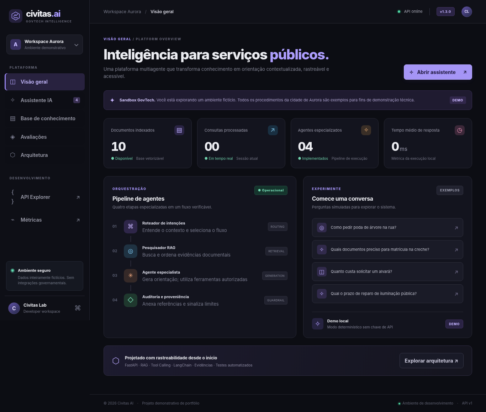
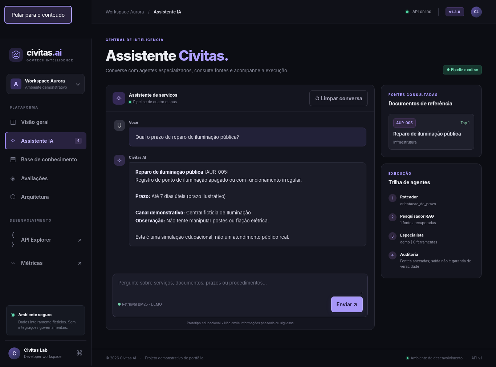
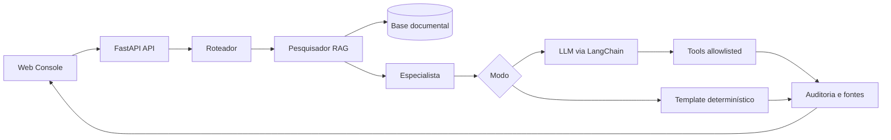

<div align="center">

# CIVITAS AI

### GovTech Intelligence · RAG · Multi-Agent Orchestration · LLM Tools · v1.3.1

**Um copiloto de serviços públicos fictícios com fontes rastreáveis, arquitetura auditável e testes de qualidade.**

     

</div>

> **Aviso ético:** todos os dados são inventados. Aurora não é uma cidade real atendida por este software. Prazos, processos e custos são apenas ilustrativos. Não fornece orientação jurídica ou serviço governamental. **Projeto de portfólio, não pronto para produção.**

## O produto

Imagine um cidadão perguntando: *"Como faço para consertar o poste apagado da minha rua?"*. O Civitas AI classifica a intenção, localiza os documentos, constrói uma resposta e mostra os **IDs das fontes**, a **trilha de execução** e o **grau relativo de similaridade** da busca.

Funciona imediatamente em modo `demo`, **sem credenciais**, com processamento local determinístico; o modo `llm` usa LangChain e modelos reais (GPT, Mistral ou Llama via Ollama) quando configurados. As duas modalidades são explicitamente identificadas na UI.

### Interface





As capturas foram feitas no Chromium com a API FastAPI conectada por ponte de teste local, pois a navegação HTTP direta do navegador ficou bloqueada neste ambiente. Mostram a interface executando consultas reais ao backend em modo demonstrativo, **não** a integração com provedores externos.

O frontend inclui **dashboard operacional**, **chat com fontes e trilhas**, **catálogo pesquisável de documentos**, **avaliações Hit@k** e **mapa de arquitetura**. Tudo em HTML/CSS/JS, servido pela própria FastAPI, sem build Node nem CDNs na interface principal (o Swagger opcional usa recursos de CDN).

## Arquitetura



| Competência do edital | Onde está no repositório |
| --- | --- |
| GPT, Llama, Mistral e LLMs | `app/config.py`, `app/agents.py` (OpenAI, Ollama, Mistral) |
| Prompt engineering | `SYSTEM_PROMPT`, controle de contexto, abstenção sem fonte |
| RAG | `app/retrieval.py` (BM25 funcional; embeddings opcionais) |
| Fine-tuning | `training/finetune_lora.py` (script experimental PEFT/LoRA, execução opcional) |
| Chatbots | Chat real conectado à API e com histórico curto |
| APIs com FastAPI | `app/main.py` e `/api/docs` |
| LangChain | `ChatOpenAI`, `@tool`, `bind_tools`, `ToolMessage` no modo `llm` |
| Multiagentes | Roteador → Pesquisador → Especialista → Auditoria |
| Tool calling | `consultar_servico`, `calcular_dias_uteis` via LLM; somente leitura |
| Aplicação GovTech | Catálogo de 10 procedimentos fictícios de serviços municipais |
| Cloud e DevOps | Docker, GitHub Actions, variáveis de ambiente e healthcheck |
| Segurança e qualidade | Rate limiting com memória limitada, validação de schemas, CSP, golden set positivo/negativo, 40 testes e pré-publicação auditável |

## Executar no Fedora (mais fácil)

```bash
# Extraia o ZIP e entre na pasta:
cd ~/Downloads/Civitas-AI
bash scripts/fedora.sh
```

O script prepara `.venv`, instala dependências, cria `.env` (se necessário), roda o pytest e inicia a API.

**Acesse:** http://127.0.0.1:8000  ·  **OpenAPI:** http://127.0.0.1:8000/api/docs

Ou manualmente:

```bash
python3 -m venv .venv
source .venv/bin/activate
pip install -r requirements-dev.txt
cp .env.example .env
pytest -q
uvicorn app.main:app --env-file .env --reload
```

### Docker

```bash
cp .env.example .env
docker compose up --build -d
docker compose ps
```

A porta fica restrita a `127.0.0.1:8000`; o contêiner roda com usuário não-root, filesystem somente leitura e volume de dados. Para encerrar: `docker compose down`.

## Usar Llama local via Ollama

Você precisa instalar Ollama conforme o site oficial, iniciar o servidor, baixar um modelo compatível com tool calling e instalar as dependências de inferência:

```bash
ollama pull llama3.2
source .venv/bin/activate
pip install -r requirements-llm.txt
```

Edite `.env`:

```dotenv
CIVITAS_MODE=llm
CIVITAS_PROVIDER=ollama
CIVITAS_MODEL=llama3.2
CIVITAS_BASE_URL=http://localhost:11434/v1
```

Reinicie a API. Sem Ollama instalado ou modelo carregado, o modo `llm` não funciona; o modo demo permanece independente. Dentro do Docker, `localhost` é o próprio contêiner: use um endereço alcançável e configure networking de maneira segura (não exponha Ollama na internet). Para Docker + LLM, defina `CIVITAS_DOCKER_WITH_LLM=true` no `.env` **antes** de `docker compose up --build`; isso adiciona LangChain à imagem. Em Linux, garanta que o host Ollama esteja acessível ao contêiner de forma restrita, sem abrir acesso público.

## Usar OpenAI ou Mistral

Instale `pip install -r requirements-llm.txt`. Em `.env`, preencha uma das opções; nunca publique chaves no Git:

**OpenAI:**

```dotenv
CIVITAS_MODE=llm
CIVITAS_PROVIDER=openai
CIVITAS_MODEL=gpt-4.1-mini
CIVITAS_API_KEY=sua-chave
```

**Mistral:**

```dotenv
CIVITAS_MODE=llm
CIVITAS_PROVIDER=mistral
CIVITAS_MODEL=mistral-small-latest
CIVITAS_API_KEY=sua-chave
```

Os identificadores de modelo mudam; consulte os catálogos atuais dos provedores. A API Mistral documenta `mistral-small-latest` e compatibilidade OpenAI (`https://docs.mistral.ai/resources/migration-guides`); Ollama documenta ferramentas na interface OpenAI (`https://github.com/ollama/ollama/blob/main/docs/api/openai-compatibility.mdx`). As rotas `ChatOpenAI` e ferramentas seguem o formato da API compatível. A compatibilidade de *tool calling* depende do provedor e modelo específicos.

## Ingestão documental

Para habilitar `POST /api/v1/documents`, configure um token forte:

```dotenv
CIVITAS_ADMIN_TOKEN=coloque-um-token-aleatorio-longo
```

No painel **Base de conhecimento**, abra *Ingestão autenticada de documentos* ou envie JSON pelo Swagger. IDs começam em `USR-`. Conteúdo é salvo em `data/uploads.json` (ignorado pelo Git) e incorporado ao índice. Exige token de pelo menos 16 caracteres. O token é apagado após envio; não é persistido pelo JavaScript. A escrita usa troca atômica, permissões 0600 e limite de 100 documentos locais por execução.

## Testes e avaliação

```bash
pytest -q
curl -s -X POST http://127.0.0.1:8000/api/v1/evaluate | python3 -m json.tool
curl -s http://127.0.0.1:8000/metrics
```

`evals/golden.json` contém 15 perguntas positivas e `evals/out_of_scope.json` contém 8 negativas. Métricas: **Hit@1**, **Hit@3** e **taxa de abstenção**; nenhuma mede a verdade de cada frase de um LLM. A suíte local atual tem **40 testes**, com **90% de cobertura de código Python**, incluindo simulação de chamadas de ferramentas sem custo de API.

**Verificação de release:**

```bash
bash scripts/verify.sh
```

O comando executa pytest, cobertura mínima de 85%, validação de sintaxe e dry-run do dataset LoRA; `ruff` é executado quando está instalado. A CI em `.github/workflows/ci.yml` inclui Ruff, smoke HTTP, auditoria de release, build Docker e um teste E2E em Chromium (ainda não executados neste ambiente). As métricas de busca são calculadas apenas no corpus fictício pequeno e não são uma validação estatística de produção.

## Fine-tuning opcional (LoRA)

```bash
pip install -r training/requirements-finetune.txt
python training/finetune_lora.py --dry-run  # valida dataset sem pesos/GPU
python training/finetune_lora.py --model Qwen/Qwen2.5-0.5B-Instruct  # treino real opcional
```

O treino baixa pesos públicos de terceiros conforme os termos de licença, consome hardware e usa somente oito exemplos **fictícios**: é uma demonstração de *pipeline*, **não** um modelo comprovadamente bom, nem treinado/testado no CI. O script gera um *adapter* LoRA; **não** o carrega automaticamente no servidor. Consulte `docs/ARQUITETURA.md`.

## Limitações e próximos passos

A base padrão possui apenas dez documentos curtos, sem chunking; o BM25 funciona bem em termos lexicais do conjunto de testes, mas falha em paráfrases fora do vocabulário. A busca híbrida com `sentence-transformers` é opcional (`CIVITAS_EMBEDDINGS=hybrid`). Agentes são **estágios especializados**: somente um estágio usa LLM no modo `llm`. Não há validação semântica de cada afirmação citada, isolamento multi-tenant, OIDC, revisão humana ou sistema de tickets de prefeitura. A arquitetura não deve ser usada com dados reais antes dessas camadas.

**Segurança adicional v1.3:** rate limiter com memória limitada, avaliação fora de domínio, citações sintaticamente validadas no modo LLM com fallback determinístico quando ausentes/inválidas, ingestão em arquivo atômico, orçamento de chamadas de ferramentas e testes de tool calling simulados, inclusive chamadas excedentes. Isso não elimina alucinação ou prompt injection. Uma fonte retornada não garante factualidade. O escore de recuperação é **relativo à consulta, não probabilidade de acerto**.

**Deploy cloud (roteiro):** [`docs/DEPLOY_CLOUD.md`](docs/DEPLOY_CLOUD.md) descreve publicação opcional no Cloud Run com acesso restrito, sem prometer produção pronta.

**Evoluções:** índices com chunking + pgvector/Qdrant; verificador de evidências por sentença; autenticação OAuth2/RBAC e isolamento de organizações; observabilidade distribuída; avaliações de factualidade, injeção de prompt e vieses; deploying seguro em nuvem.

Para testar e apresentar: [`docs/GUIA_TESTE_E_PUBLICACAO.md`](docs/GUIA_TESTE_E_PUBLICACAO.md) · [`docs/DEMO_ENTREVISTA.md`](docs/DEMO_ENTREVISTA.md).

Para aprofundamento: [`docs/ARQUITETURA.md`](docs/ARQUITETURA.md) · [`docs/SEGURANCA.md`](docs/SEGURANCA.md) · [`docs/APRESENTACAO.md`](docs/APRESENTACAO.md) · [`docs/STATUS.md`](docs/STATUS.md) · [`docs/TEST_REPORT.md`](docs/TEST_REPORT.md)

## Antes de publicar: testes e revisão

```bash
bash scripts/fedora.sh --check   # instala, roda testes + smoke HTTP + auditoria
bash scripts/fedora.sh           # abre o servidor demo para testar no navegador
```

A CLI de publicação também executa `scripts/prepublish.sh` antes de permitir um commit. Para rodar um teste automatizado de navegador no **seu Fedora**, veja [`docs/GUIA_TESTE_E_PUBLICACAO.md`](docs/GUIA_TESTE_E_PUBLICACAO.md). A navegação HTTP direta do Chromium foi bloqueada pela política deste ambiente. Uma ponte local permitiu validar dashboard, chat, busca e avaliação no Chromium, mas o E2E HTTP completo deve ser executado no Fedora e no GitHub Actions.

**O que significa "pronto":** pronto para **teste local e publicação como portfólio demonstrativo**, ainda **não** pronto para operação pública ou para afirmar que GPT/Mistral/Ollama, embeddings híbridos, treinamento LoRA e Docker funcionam em produção sem validar cada integração.

## Publicar no GitHub — `thiagojbarbosa0`

**Um único projeto, uma única branch principal, nenhum histórico de versões de ZIPs.** A rotina instala as dependências e roda o Ruff obrigatoriamente, além de verificar a conta autenticada e **só** cria `thiagojbarbosa0/Civitas-AI` após aprovação. Não altera seus outros repositórios. Como o projeto é demonstrativo, a publicação não faz deploy nem configura serviços pagos.

1. Baixe `Civitas-AI_FINAL_GITHUB.zip` para `~/Downloads`.
2. Cole no terminal do Fedora:

```bash
sudo dnf install -y git gh python3 python3-pip unzip
cd "$HOME/Downloads"
DESTINO="$(mktemp -d "$HOME/Downloads/civitas-publicar-XXXXXX")"
unzip -q Civitas-AI_FINAL_GITHUB.zip -d "$DESTINO"
cd "$DESTINO/Civitas-AI"
bash scripts/publicar_fedora.sh
```

O script solicita login no GitHub, caso necessário, instala dependências de desenvolvimento em `.venv`, executa a verificação local, audita o conteúdo preparado no Git e pede que você digite `PUBLICAR`. Ele **recusa** se o login ativo não for `thiagojbarbosa0`, se já houver `origin` ou se o repositório de destino existir. Caso o Git não tenha autor configurado, usa o login e e-mail `noreply` calculado a partir do ID do usuário GitHub, sem alterar configurações globais.

Depois visite `https://github.com/thiagojbarbosa0/Civitas-AI/actions`. Aguarde os jobs `tests`, `docker-build` e `browser-smoke`; se algum falhar, corrija antes de compartilhar a candidatura. O script testa o modo demo, não confirma LLM externo nem uso em produção.

## Licença

Código próprio licenciado sob MIT. Conteúdos simulados não possuem validade administrativa. Dependências e modelos externos mantêm suas próprias licenças.
