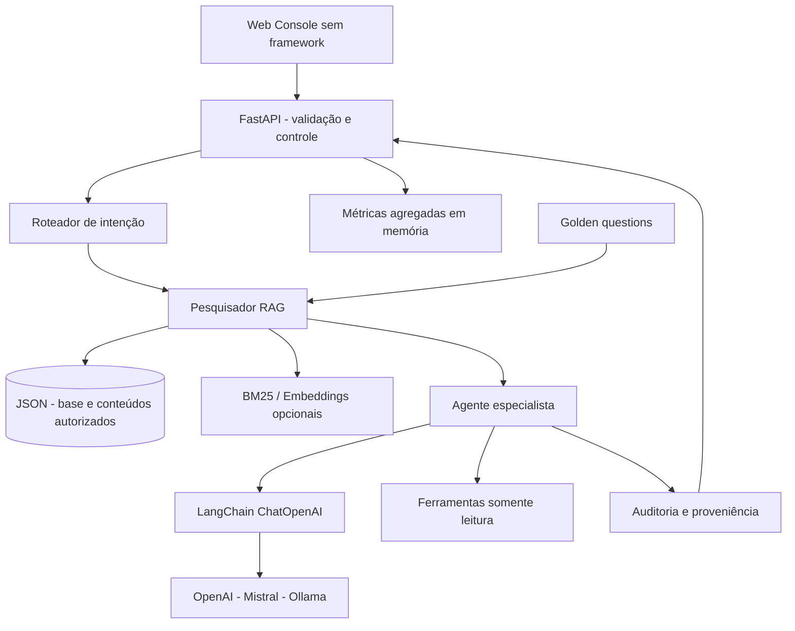

# Arquitetura técnica — Civitas AI 1.2

## Contexto e escopo

A demonstração acompanha serviços públicos da **cidade inventada de Aurora**. Nenhum serviço, prazo ou cobrança representa uma prefeitura real. Não há identidade de cidadão, protocolo verdadeiro, transação financeira ou integração governamental. Projeto *portfolio-grade*, ainda **não production-grade**.

## Componentes



### Fluxo completo

1. **Web client** envia mensagem via JSON para `POST /api/v1/chat`. O histórico fornecido é validado, truncado a seis mensagens e não é gravado.
2. **FastAPI** aplica rate limiting simples por IP, valida esquemas Pydantic e restringe tamanho da entrada.
3. **Intent router** usa regras lexicais para selecionar tipo de resposta. Isso é explicitamente *determinístico*, não um classificador treinado.
4. **Retriever** usa BM25 (IDF e normalização de comprimento), ordena os documentos inteiros, exige cobertura lexical mínima dos termos informativos e anexa no máximo três referências. Modo híbrido integra vetores reais de `sentence-transformers` e faz fusão ponderada. Para corpus real, implementar *chunking* e reranking.
5. **Specialist** responde por regras (modo `demo`) ou realiza inferência real via LangChain (`llm`). O modelo tem duas tools explicitamente enumeradas: `consultar_servico` e `calcular_dias_uteis`; no máximo três rodadas de chamadas e três ferramentas por rodada.
6. **Evidence stage** anexa os IDs recuperados, verifica sintaticamente citações do LLM e aplica fallback determinístico quando elas são ausentes ou inválidas. Registra a trilha de execução. **Importante**: um ID sintaticamente válido não garante verdade: uma fonte recuperada **não comprova** que toda afirmação do modelo esteja apoiada nessa fonte. Esta é uma limitação conhecida; falta verificação de entailment por trecho.
7. **Telemetry** contabiliza consultas, presenças/ausências de fonte, erros e tempo médio. Não contém conteúdo de conversas.

### Pseudocódigo

```python
intent = route(query)
hits = retrieve(query, top_k=3)
if not hits:
    return abstain()
answer = deterministic_template(hits) if demo else langchain_agent(hits, allowlisted_tools)
return {"answer": answer, "sources": hits, "trace": stages}
```

## Dados

`app/knowledge/services.json` contém 10 documentos estruturados, com `id`, `title`, `category`, `summary`, `requirements`, `steps`, `deadline`, `fee`, `channel`, `notes`, `tags`. `data/uploads.json` é criado por ingestão autenticada e ignorado no Git.

A ingestão não executa URLs, scripts, ferramentas ou código de documentos. Não existe upload de PDF ou crawler; adicionar isso exigiria pipeline de validação, parser seguro, chunking, proveniência e controle de permissões.

## Integração LLM

`CIVITAS_MODE=llm` importa `langchain_openai.ChatOpenAI` com `base_url` customizável. OpenAI, Mistral e Ollama operam com versões de API de chat compatíveis. Modelos locais devem suportar chamadas de ferramenta para utilizar a feature de tool calling; se não suportarem, podem ocorrer erros e a API retorna status de falha sem armazenar conteúdo. O sistema não transfere prompts ao provedor quando em `demo`.

## Fine-tuning

`training/finetune_lora.py` é um **script opcional** de ajuste supervisionado via PEFT/LoRA com pequeno conjunto ilustrativo. Ele produz um **adapter**, não um modelo pronto para produção, e não se conecta automaticamente ao runtime. Para produção: dataset com licença e consentimento, divisão treino/validação/teste, baseline, avaliação cega, viés/privacidade, rastreamento de experimentos, registro de modelos e serving explícito.

## Escalabilidade

O indexador trabalha sobre documentos completos em memória e tem custo de busca linear com o número de documentos. Métricas e limites vivem no processo, não são compartilhados entre réplicas. Adaptações recomendadas para escala: índice persistente (pgvector/Qdrant), chave por tenant, Redis rate limit, filas para tarefas pesadas, autenticação OIDC e métricas Prometheus com distribuição por instância.

## Política de avaliação

O endpoint `POST /api/v1/evaluate` mede 15 buscas positivas e 8 negativas. Casos de avaliação **não contam** como conversas reais na telemetria. Os escores BM25 normalizados são relativos ao ranking por consulta, não calibração probabilística.

## Persistência local

Os uploads usam lock em processo único, arquivo temporário exclusivo, permissões 0600 e substituição atômica. O limite padrão é 100 documentos adicionais. Para múltiplas réplicas, usar banco compartilhado com transações, migrações e autenticação real.
